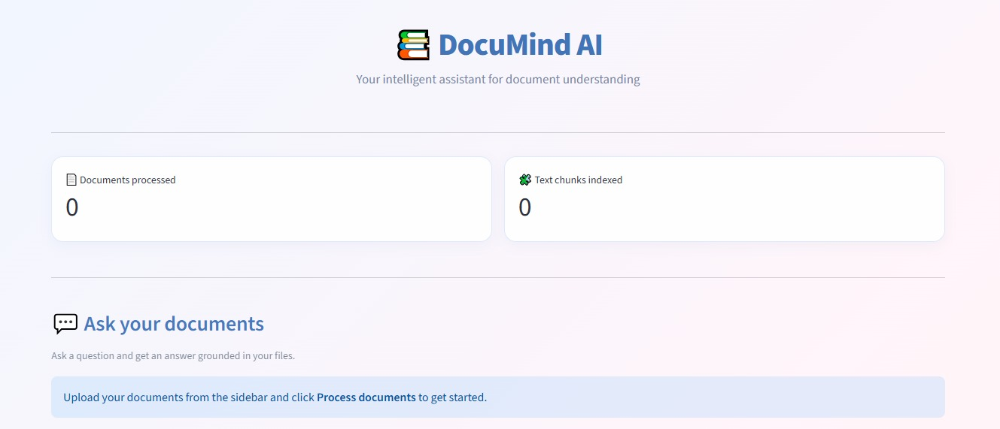
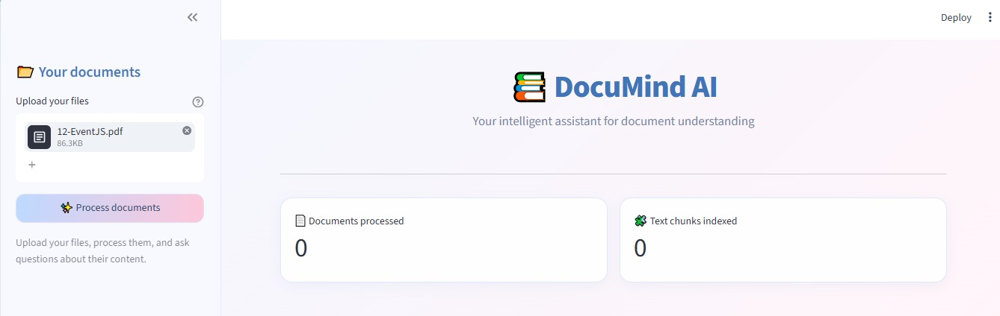
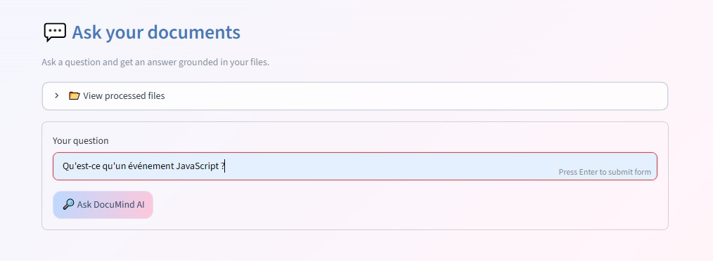
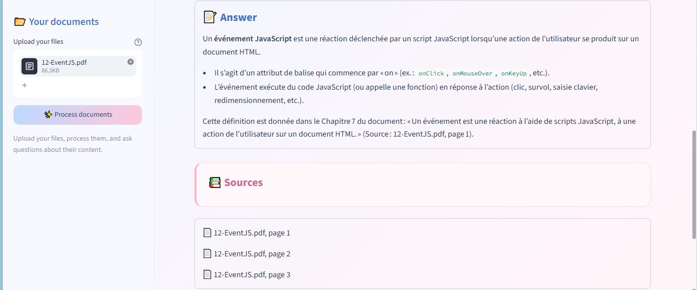
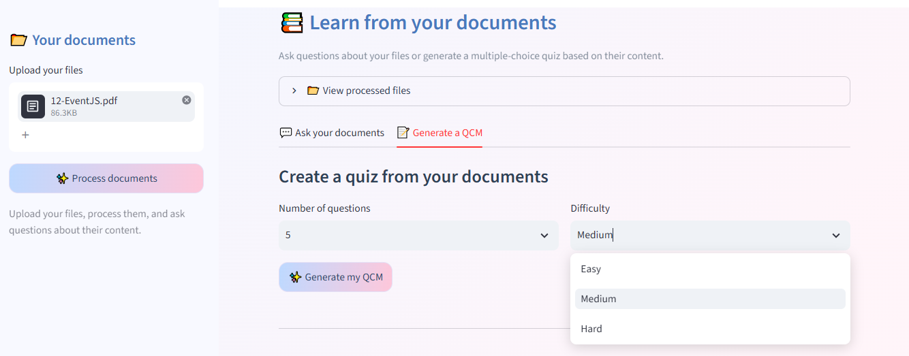
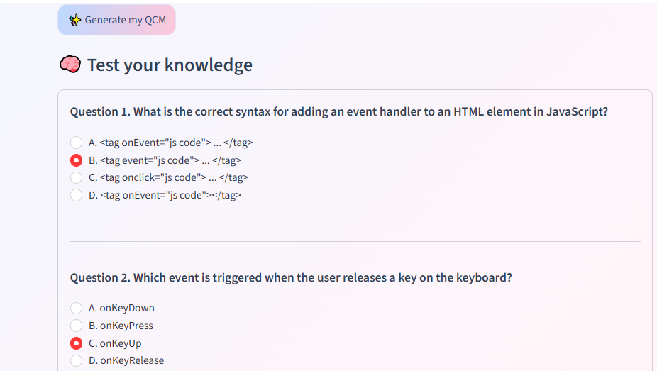
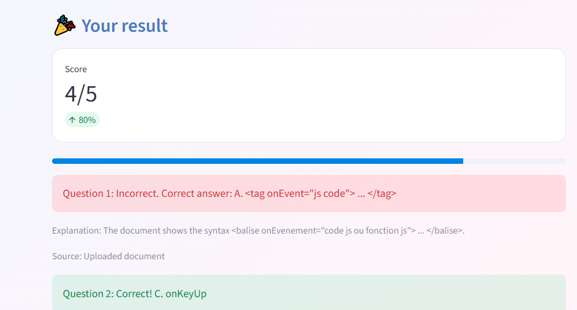

# 📚 DocuMind AI — Intelligent Document Assistant

[](https://documind-ia-majrisalma.streamlit.app/)

**Try the live application:** [DocuMind AI](https://documind-ia-majrisalma.streamlit.app/)

DocuMind AI is an AI-powered document assistant that allows users to upload documents, ask questions about their content, and generate interactive multiple-choice quizzes (QCMs) to test their understanding.

Built with **Retrieval-Augmented Generation (RAG)**, semantic search, and the Groq API, the application provides context-based answers and generates quizzes from uploaded documents.

## ✨ Features

- 📂 Upload PDF, DOCX, TXT, and Markdown files.
- 🧠 Extract text and split documents into manageable chunks.
- 🔎 Search documents using semantic similarity.
- 🤖 Generate contextual answers using the Groq API.
- 📚 Display source references to help users verify answers.
- 📝 Automatically generate multiple-choice quizzes from uploaded documents.
- 🎯 Choose the number of questions and difficulty level: Easy, Medium, or Hard.
- ✅ Submit answers and receive automatic scoring.
- 💡 View correct answers, explanations, and available source references.
- 📊 Track processed documents and indexed text chunks.
- 🎨 Enjoy a clean interface with a pastel blue-and-pink design.

## 🌐 Live Demo

Try the application online:

👉 **[Launch DocuMind AI](https://documind-ia-majrisalma.streamlit.app/)**

Upload a document, process it, ask questions, or generate a QCM based on its content.

## 🖥️ Screenshots

### 1. Dashboard and Document Upload



### 2. Document Upload



### 3. Ask Your Documents



### 4. AI Answer and Sources



### 5. QCM Generation

Choose the number of questions and select the difficulty level before generating a quiz from your documents.



### 6. Interactive QCM

Answer multiple-choice questions generated from the content of your uploaded documents.



### 7. QCM Results and Feedback

Get your score, check the correct answers, and review explanations to improve your understanding.



## 🛠️ Technologies Used

- **Python** — Application logic and document processing
- **Streamlit** — Interactive web interface
- **RAG (Retrieval-Augmented Generation)** — Context-based question answering
- **Sentence Transformers** — Text embeddings
- **FAISS** — Vector similarity search
- **Groq API** — AI-powered answer and quiz generation
- **Hugging Face** — Pre-trained embedding models
- **pypdf** — PDF text extraction
- **python-docx** — DOCX text extraction
- **NumPy** — Numerical operations

## ⚙️ How It Works

1. **Document Upload:** Users upload supported documents through the Streamlit interface.
2. **Text Extraction:** The application extracts readable text from the uploaded files.
3. **Text Splitting:** Extracted content is divided into smaller chunks.
4. **Embedding Generation:** Sentence Transformers converts the text chunks into numerical embeddings.
5. **Semantic Search:** FAISS retrieves relevant chunks based on the user's question.
6. **Answer Generation:** The retrieved context is sent to the Groq API to generate a relevant answer.
7. **QCM Generation:** The Groq API generates multiple-choice questions based on the processed document content.
8. **Quiz Evaluation:** Users submit their answers and receive their score, correct answers, and explanations.

## 🧠 Architecture

DocuMind AI combines local document processing and semantic retrieval with cloud-based language generation.

- **Document processing:** Extracts and prepares uploaded content.
- **Embedding model:** Converts text chunks into vector representations.
- **FAISS vector search:** Retrieves relevant information from processed documents.
- **Groq API:** Generates context-based answers and multiple-choice questions.
- **Streamlit:** Provides the interactive user interface for document analysis and quiz evaluation.

## 📁 Project Structure

```text
DocuMind-AI/
│
├── app/
│   ├── main.py
│   ├── document_loader.py
│   ├── text_splitter.py
│   ├── vector_store.py
│   └── rag_pipeline.py
│
├── images/
│   ├── 1.png
│   ├── 2.png
│   ├── 3.png
│   ├── 4.png
│   ├── 5-qcm-generation.png
│   ├── 6-qcm-questions.png
│   └── 7-qcm-results.png
│
├── .env.example
├── .gitignore
└── requirements.txt
```

## 🔐 Security and Configuration

The application uses a Groq API key to access the language model.

For local development, configure the required environment variables in a `.env` file or your local environment.

For deployment, configure the required secrets in Streamlit Community Cloud.

**Never commit API keys or private credentials to GitHub.** Keep `.env` excluded through `.gitignore`.

## 🚀 Future Improvements

- 📄 Support additional document formats.
- 💬 Improve conversational memory for follow-up questions.
- 📈 Add quiz history and progress tracking.
- 🌍 Support more languages for questions and generated quizzes.
- 📤 Export generated quizzes and results.

## 👩‍💻 Author

**Salma Majri**

